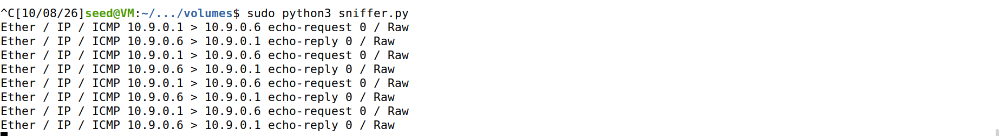
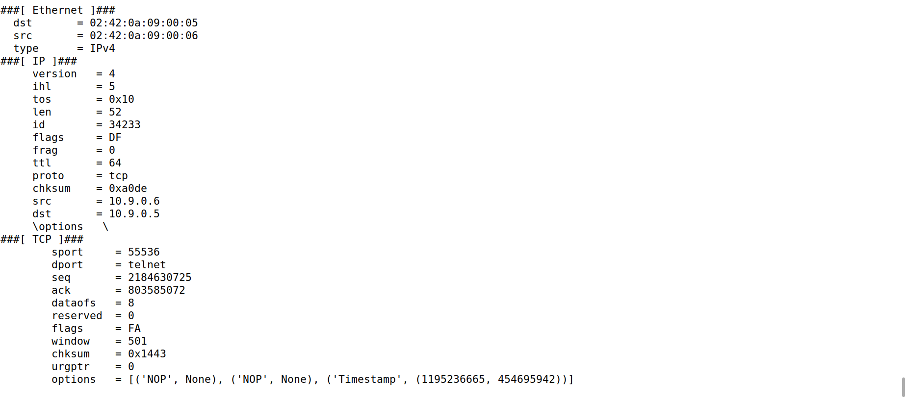
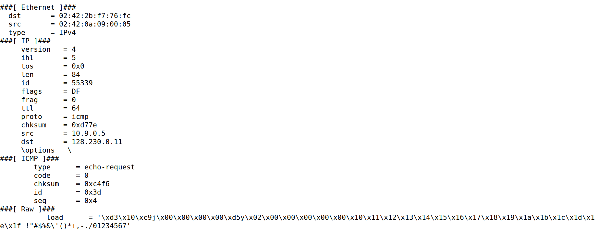
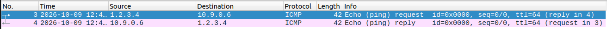

# Packet sniffing and spoofing lab

Python scripts written with Scapy for the Packet Sniffing and Spoofing lab
(SEED Labs), completed as part of the Network Security module of my MSc in Software Design with Cybersecurity at Technological University of the Shannon.

The lab runs on an Ubuntu 20.04 virtual machine, with an attacker and two
hosts (10.9.0.5 and 10.9.0.6) running as Docker containers on an isolated
network. These scripts are for that lab network only.

## Files

| File | What it does |
| --- | --- |
| `sniff.py` | My own command-line sniffer. Takes the interface, filter and packet count as options. |
| `sniffer.py` | Lab task: capture ICMP packets. |
| `sniffer2.py` | Lab task: capture TCP packets from one host to port 23 (telnet). |
| `sniffer3.py` | Lab task: capture packets to or from a chosen subnet. |
| `spoof.py` | Lab task: send an ICMP echo request. |
| `spoof2.py` | Lab task: send an ICMP echo request with a spoofed source address. |

## Using sniff.py

Find the lab network interface, then run the sniffer with root privileges:

```
ip -br link | grep br-
sudo python3 sniff.py --iface br-xxxxxxxxxxxx --filter icmp --count 4
```

Other filters use the same syntax, for example `--filter "tcp and dst port 23"`.
Add `--full` to print every field of each packet.

## Screenshots

Sniffer capturing ping requests and replies:



Telnet filter: a captured TCP packet going to port 23:



Subnet filter: a captured packet going to the 128.230.0.0/16 subnet:



Spoofing: Wireshark shows a ping that claims to come from 1.2.3.4, and the host replying to that fake address:



## What I learned

- How capture filters select traffic by protocol, host, port and subnet.
- How a packet is built layer by layer, and how easily a source address can be forged.
- How to run an isolated test network with Docker.
